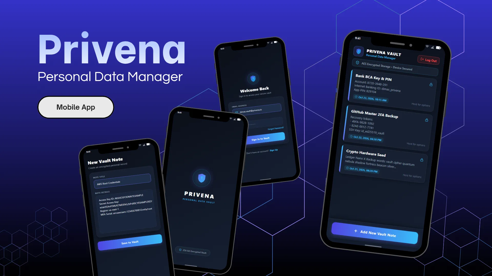
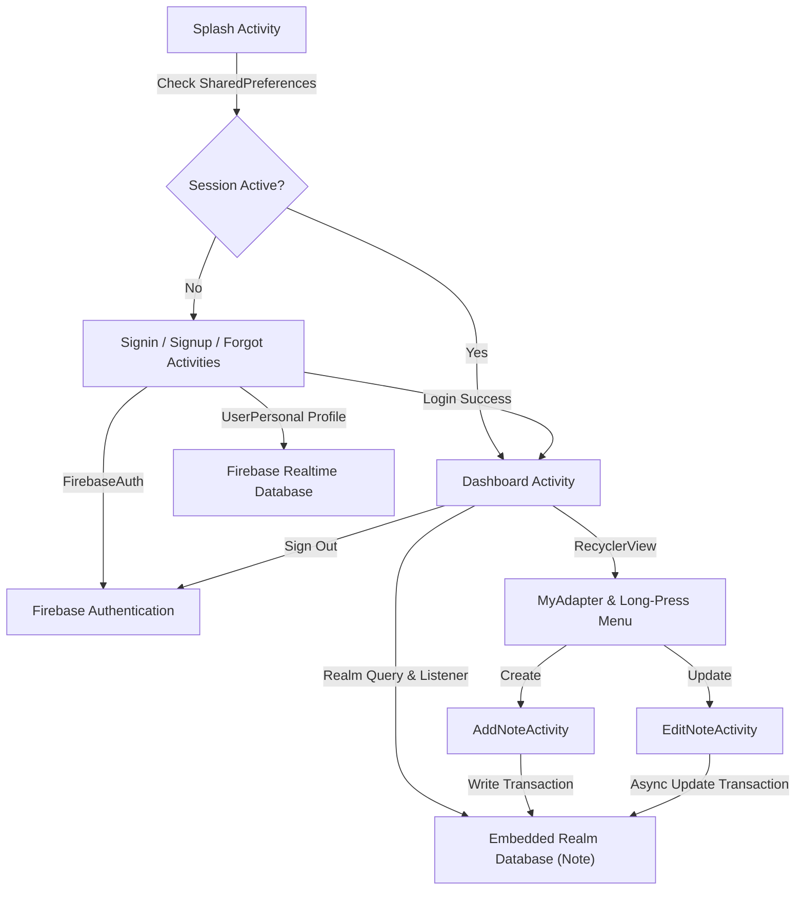
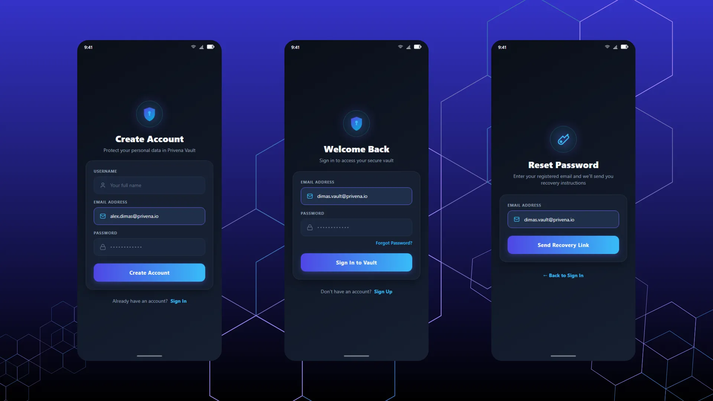
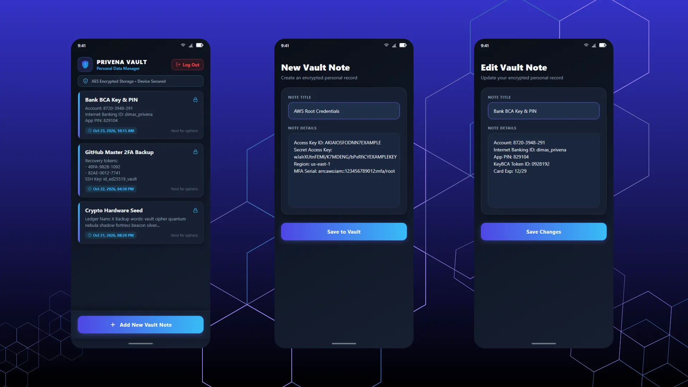

# Privena - Personal Data Management




## Project Overview

Privena - Personal Data Management is a native Android mobile application designed as a personal data vault for storing, viewing, editing, and organizing private notes and account records on mobile devices. It addresses the everyday challenge of keeping sensitive personal references separated from general-purpose note apps by pairing user account authentication with an on-device object database. Built for Android users seeking a focused, dark-themed personal vault workflow, the application combines Firebase Authentication and Firebase Realtime Database for account management with Realm for responsive local note persistence.

## Key Features

- **Branded Splash & Session Routing**: Displays a 3-second branded splash screen (`Splash`) and checks `SharedPreferences` session state to route returning users to the dashboard or sign-in screen.
- **Account Registration & Authentication**: Supports email-and-password sign-up (`Signup`) and sign-in (`Signin`) powered by Firebase Authentication, storing user profile records (`UserPersonal`) in Firebase Realtime Database.
- **Password Recovery Flow**: Provides an in-app password reset workflow (`Forgot`) that dispatches recovery instructions through `FirebaseAuth.sendPasswordResetEmail`.
- **Vault Dashboard with Reactive List**: Renders stored `Note` records inside a `RecyclerView` sorted chronologically in descending order by creation timestamp, automatically updating the UI via a `RealmChangeListener`.
- **Create & Edit Vault Notes**: Offers dedicated screens (`AddNoteActivity` and `EditNoteActivity`) with ViewBinding/layout forms and input validation for saving and updating note titles and details.
- **Long-Press Context Actions**: Implements a card long-press `PopupMenu` in `MyAdapter` allowing users to jump directly to editing or delete an entry from the local Realm store.
- **Secure Session Sign-Out**: Includes a dedicated log-out action in the dashboard header that signs the current user out of `FirebaseAuth` and returns to the sign-in screen.

## Supported Platforms

| Platform | Operating System | Minimum Version | Support / Test Status |
| --- | --- | --- | --- |
| Mobile | Android | Android 7.0 (API 24 / Nougat) | Configured target (`minSdk 24`, `targetSdk 32`, `compileSdk 32`); built with Android Studio & Gradle |

## Tech Stack

| Category | Technology | Purpose |
| --- | --- | --- |
| Primary Language | Java | Core application logic, Activities, models, and adapters (`JavaVersion.VERSION_1_8`) |
| Mobile Framework | Android SDK (`compileSdk 32`) | Native Android Activity lifecycle, intents, and UI rendering |
| UI & Layout | AndroidX AppCompat, Material Components, ConstraintLayout, RecyclerView | Dark-mode vault layouts, vector drawables, custom cards, and scrollable note lists |
| View Binding | Android ViewBinding | Type-safe view references in `Splash`, `Signin`, `Signup`, and `Forgot` activities |
| Authentication | Firebase Authentication (`firebase-auth`) | Email/password registration, sign-in, session sign-out, and password reset emails |
| Cloud User Store | Firebase Realtime Database (`firebase-database`) | Storing `UserPersonal` (`username`, `email`) profiles keyed by Firebase UID |
| Local Database | Realm (`realm-android` / `RealmObject`) | Embedded local storage, querying, sorting, and live change notifications for `Note` objects |
| Local Preferences | Android `SharedPreferences` | Lightweight local persistence for session flags (`autologin`, `unique` UID) |
| Build & Dependency Management | Gradle Wrapper & Android Gradle Plugin | Dependency resolution via Firebase BoM, Realm plugin integration, and APK compilation |

## Application Architecture

Privena follows a native Android multi-Activity architecture organized around an authentication module and a local vault dashboard module. On launch, `Splash` evaluates local session state in `SharedPreferences` and navigates either to the authentication Activities (`Signin`, `Signup`, `Forgot`) backed by Firebase Authentication and Firebase Realtime Database, or directly to `Dashboard`. Inside `Dashboard`, `MyAdapter` binds `RealmResults<Note>` queried from the embedded Realm database and responds to user actions across `AddNoteActivity` and `EditNoteActivity`.



## Screenshots / Preview

### 1. Authentication & Account Recovery Flow

A three-screen overview of the user onboarding and access flow, featuring the **Create Account** registration form (`Signup`), the **Welcome Back** email-and-password login screen (`Signin`), and the **Reset Password** recovery interface (`Forgot`) with dark gradient surfaces and custom vector icons.

### 2. Vault Dashboard & Note Management Flow

The core personal vault workspace showing the **Privena Vault** dashboard (`Dashboard`) with timestamped note cards, long-press context hints, a header **Log Out** button, and a bottom **Add New Vault Note** dock alongside the **New Vault Note** (`AddNoteActivity`) and **Edit Vault Note** (`EditNoteActivity`) forms.

## Prerequisites

- **Operating System**: Windows, macOS, or Linux capable of running Android Studio
- **Java Development Kit (JDK)**: JDK 8 or compatible JDK configured with Java 1.8 source/target compatibility
- **Android Studio & Android SDK**: Android SDK Platform 32 (`compileSdk 32`) and Android SDK Build-Tools
- **Gradle**: Included via Gradle Wrapper (`gradlew` / `gradlew.bat`, configured for Gradle `7.4`)
- **Firebase Project Configuration**: A valid `app/google-services.json` linked to a Firebase project with Email/Password Authentication and Realtime Database enabled
- **Target Device or Emulator**: Physical Android device or Android Emulator running Android 7.0 (API level 24) or higher

## Installation & Setup

1. Clone the repository to your local machine:
   ```bash
   git clone https://github.com/weztcy/Privena-Personal-Data-Management.git
   cd "Privena - Personal Data Management"
   ```
2. Open the project folder in **Android Studio** and allow Gradle to sync dependencies (`firebase-bom:31.1.1`, `realm-gradle-plugin:10.8.0`, and AndroidX libraries).
3. Verify that `app/google-services.json` corresponds to your Firebase project with **Firebase Authentication (Email/Password)** and **Firebase Realtime Database** enabled.
4. Build the debug APK using the included Gradle Wrapper:
   ```bash
   ./gradlew assembleDebug
   ```
   On Windows PowerShell or Command Prompt:
   ```powershell
   .\gradlew.bat assembleDebug
   ```
5. Connect an Android device (with USB debugging enabled) or start an Android Emulator (API 24+), then install and launch the application from Android Studio or via Gradle:
   ```bash
   ./gradlew installDebug
   ```

## Application Configuration

Core project and SDK settings are managed through Gradle build scripts and Android XML manifests rather than external `.env` files.

| Configuration | Description | Default / Example |
| --- | --- | --- |
| `applicationId` | Unique Android application package identifier in `app/build.gradle` | `com.yodimpra.personaldata` |
| `minSdk` / `targetSdk` | Minimum and target Android API levels supported by the build | `24` (Android 7.0) / `32` (Android 12L) |
| `google-services.json` | Firebase project metadata linking Auth and Realtime Database | `app/google-services.json` |
| `org.gradle.jvmargs` | JVM memory and UTF-8 encoding settings in `gradle.properties` | `-Xmx2048m -Dfile.encoding=UTF-8` |
| `android.useAndroidX` | Enables AndroidX library namespaces in `gradle.properties` | `true` |

## Database & Local Storage

Privena separates remote user identity metadata from on-device note storage by combining Firebase Realtime Database with an embedded Realm database and Android `SharedPreferences`. Cloud storage handles registered user metadata (`UserPersonal` objects containing `username` and `email`), while all vault notes (`Note` objects containing `title`, `description`, and `createdTime`) reside locally inside the application's Realm database on the device.

| Storage Mechanism | Scope | Stored Data & Behavior |
| --- | --- | --- |
| Realm (`io.realm.Realm`) | Local On-Device | Stores `Note` (`RealmObject`) records, queried in descending `createdTime` order with `RealmChangeListener` UI updates |
| Firebase Realtime Database | Remote Cloud | Stores `UserPersonal` (`username`, `email`) entries under `userpersonal/<uid>` during user registration |
| `SharedPreferences` | Local On-Device | Stores lightweight session flags (`autologin`, `unique`) in private app storage |

## Authentication & Authorization

User identity and vault access control are handled through Firebase Authentication and activity-level routing.

- **Email & Password Registration**: `Signup` creates credentials via `FirebaseAuth.createUserWithEmailAndPassword` and writes the user's `UserPersonal` record to Firebase Realtime Database under their unique Firebase UID.
- **Email & Password Sign-In**: `Signin` authenticates users via `FirebaseAuth.signInWithEmailAndPassword` and navigates to `Dashboard` upon success.
- **Password Recovery**: `Forgot` sends password reset emails to registered accounts using `FirebaseAuth.sendPasswordResetEmail`.
- **Session Sign-Out**: `Dashboard` provides a **Log Out** button that invokes `FirebaseAuth.getInstance().signOut()` and redirects the user back to `Signin`.

## Build & Packaging

The project uses Gradle (`7.4`) with Android Gradle Plugin (`7.3.1`) and the `realm-android` and `com.google.gms.google-services` plugins to compile Java 8 bytecode and package Android APK artifacts.

1. Clean previous build outputs if needed:
   ```bash
   ./gradlew clean
   ```
2. Assemble a debug APK for device or emulator testing:
   ```bash
   ./gradlew assembleDebug
   ```
3. Assemble a release APK (configured in `app/build.gradle` with `minifyEnabled false` and `proguard-rules.pro`; requires release signing configuration in Android Studio or Gradle):
   ```bash
   ./gradlew assembleRelease
   ```

## Usage

After installing and launching Privena on an Android device or emulator (API 24+), you can manage your personal vault notes through the following workflow:

1. Wait for the **Splash** screen (`Splash`) to finish its initial routing check.
2. On the **Welcome Back** (`Signin`) screen, sign in with an existing email and password, tap **Register Now** (`Signup`) to create a new account, or tap **Forgot Password?** (`Forgot`) to request a password reset email.
3. Once authenticated, view your chronological list of saved entries on the **Privena Vault** (`Dashboard`) screen.
4. Tap **Add New Vault Note** at the bottom dock to open `AddNoteActivity`, enter a **Note Title** and **Note Details**, and tap **Save to Vault** to store the note locally in Realm.
5. Long-press any note card on the dashboard to open the context menu, then select **EDIT** to update the entry in `EditNoteActivity` or **DELETE** to remove it from the local database.
6. Tap **Log Out** in the top-right corner of the dashboard to end your Firebase session and return to the sign-in screen.

## Contributing

Contributions are welcome to improve the application, fix issues, or enhance existing features. Follow this workflow when submitting changes:

1. Fork the repository.
2. Create a branch for the change.
3. Make the changes.
4. Validate or test the changes when applicable.
5. Commit and push the branch.
6. Open a pull request with a clear explanation.

## License

This project is licensed under the MIT License.
See the [LICENSE](LICENSE) file for details.

## Author & Contact

**Yohanes Dimas Pratama**

- GitHub: [github.com/weztcy](https://github.com/weztcy)
- Portfolio: [yohanesdimas.com](https://yohanesdimas.com)
- LinkedIn: [linkedin.com/in/yohanes-dimas](https://www.linkedin.com/in/yohanes-dimas)
